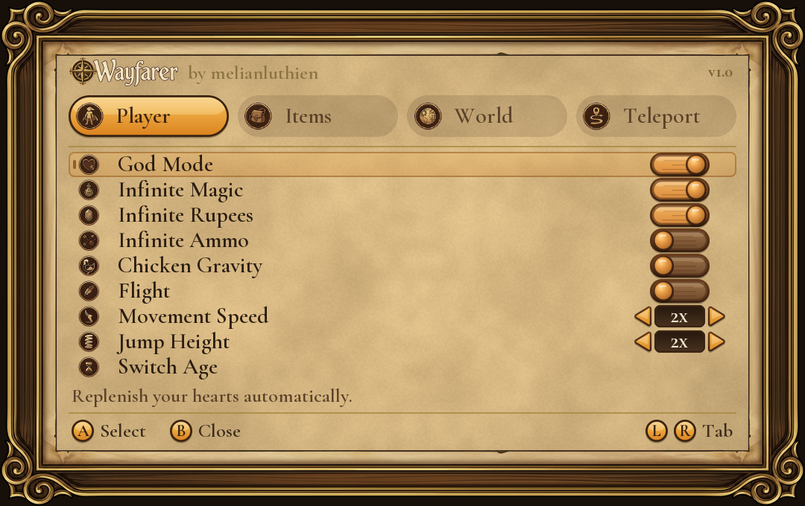
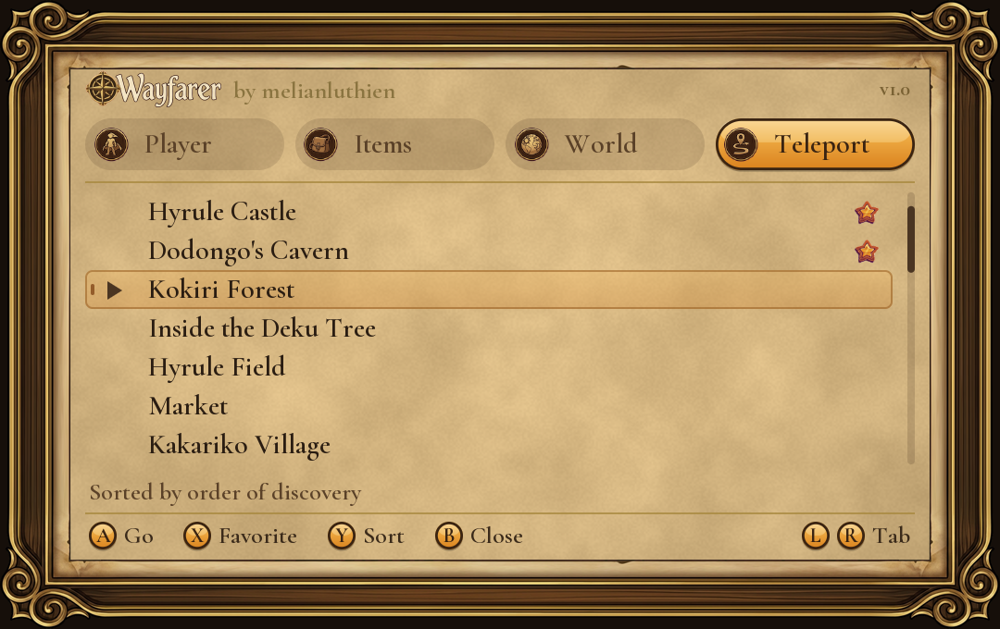
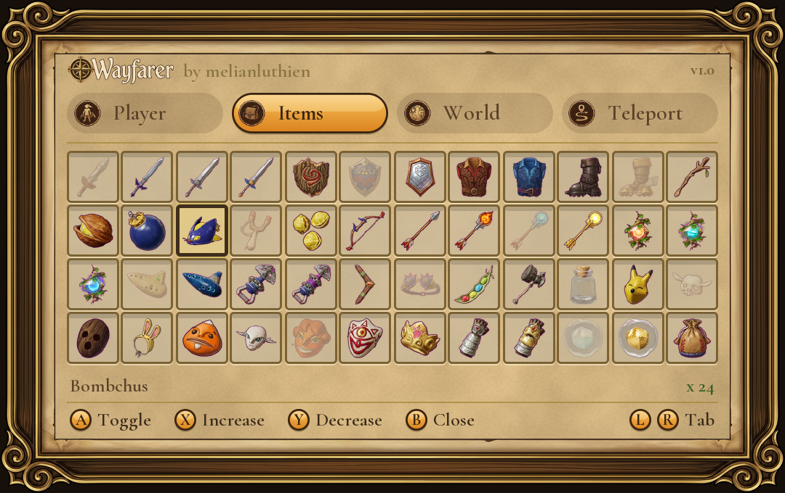
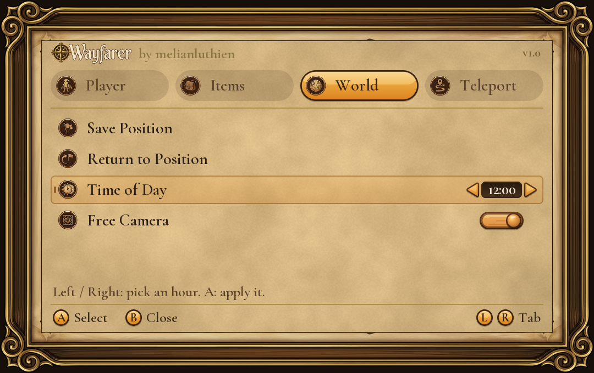

<p align="center">
  
</p>

<p align="center">
  An in-game cheat menu for<br>
  <strong>The Legend of Zelda: Ocarina of Time Remake</strong>
</p>

<p align="center">
  <kbd>v1.0</kbd> &nbsp; <kbd>GPL-3.0</kbd> &nbsp; <kbd>by melianluthien</kbd>
</p>

<p align="center">
  <a href="#features">Features</a> ·
  <a href="#installation">Installation</a> ·
  <a href="#using-the-menu">Using the menu</a> ·
  <a href="#status">Status</a> ·
  <a href="#building-from-source">Building from source</a> ·
  <a href="#credits-and-license">Credits</a>
</p>

---

Press **R3** while you play and a carved-wood pause menu opens over the game. Wayfarer is a standalone ExeFS mod: it runs inside the emulator with the game, needs no separate trainer, and never goes online.

<p align="center">
  
  
</p>

<p align="center">
  
  
</p>

## Features

### Player

| Cheat | What it does |
| --- | --- |
| **God Mode** | Replenishes your hearts automatically. |
| **Infinite Magic** | Your magic never runs out. |
| **Infinite Rupees** | Your wallet is always full. |
| **Infinite Ammo** | Arrows, bombs, Bombchus, Deku Sticks, Deku Nuts and Deku Seeds refill to your current capacity. |
| **Chicken Gravity** | Fall slowly, as if carrying a cucco. |
| **Flight** | Fly freely: the left stick moves, **ZR** rises, **ZL** descends. |
| **Movement Speed** | Run at 1x, 1.5x, 2x or 3x. |
| **Jump Height** | Jump at 1x, 2x, 3x or 5x. |
| **Switch Age** | Swap between child and adult Link (the map reloads). |

The refills only top you up to what you already have: 30 bombs in a 30-bomb bag, a wallet at its current size. They never raise a capacity, and they leave items you haven't found alone.

### Items

Every item in the game, as an icon grid: swords, shields, tunics, boots, bows and bags, the three Gifts (**Improved Spin**, **Doubled Magic**, **Halved Damage**), spiritual stones, medallions, all twelve songs, the **Echo Gem**, the **Gerudo Pass** and Gold Skulltula Tokens. Press **A** to give or take an item, and **X** / **Y** to raise or lower the amount of anything that has a quantity.

### World

| Option | What it does |
| --- | --- |
| **Save Position** | Remember where you are standing. |
| **Return to Position** | Go back to your saved spot. |
| **Time of Day** | Pick an hour with Left / Right and apply it with **A**. |
| **Free Camera** | Fly the camera around while Link stands still. Sticks move and look, **ZR** / **ZL** rise and descend, **A** speeds up. |

### Teleport

Thirty-one places, from Kokiri Forest to Ganon's Castle, sorted either **alphabetically** or in the **order you would discover them** on a first playthrough. Press **Y** to switch the sort and **X** to star your favorites; favorites always float to the top.

## Installation

You need the game (title ID `0400486024DEC000`, version **1.1.1**, build ID `E0F3CCFAF50065AE4EA01EB5AEB13B1A45DA3348`) running in **Lichii**. Wayfarer ships no game files.

1. Download `Wayfarer-v1.0.zip` from the [Releases](../../releases) page and unzip it. You get a folder named `Wayfarer` with an `exefs` folder inside.
2. Close the game. In Lichii, right-click the game and choose **Open Mod Data Location**.
3. Copy the whole `Wayfarer` folder in there. Inside, `exefs` must hold `subsdk8` and a file named after the build ID with the `.ips` extension.
4. Start the game, load a save and click the right stick (**R3**) during gameplay.

**Uninstall:** close the game and delete the `Wayfarer` folder.

> [!IMPORTANT]
> Wayfarer uses the `subsdk8` slot. Don't run it together with another mod that also ships a `subsdk8`, and keep any other in-game menu closed while Wayfarer's is open.

## Using the menu

| Input | Action |
| --- | --- |
| **R3** | Open or close the menu |
| **D-pad Up / Down** | Move the selection |
| **D-pad Left / Right** | Change a value (speed, jump, hour); on Teleport, jump a page |
| **A** | Switch the selected cheat on or off, or run the selected action |
| **B** | Close the menu |
| **L / R** | Previous / next tab |
| **X / Y** | Items: more / less. Teleport: favorite / sort |

The first time you switch a cheat on in a session, Wayfarer warns that cheats are experimental. Press **A** to accept.

While the menu is open the game doesn't see your inputs. **Free Camera** closes the menu so you can look around; press **R3** to bring it back. R3 does nothing during scripted scenes and some minigames.

> [!TIP]
> Cheats can crash the game or damage a save. Play with a **copy of your save**. To back one up, close the game, open its save data location from Lichii and copy that folder.

## Status

Wayfarer 1.0 is the first public release.

- Written and tested by hand on **Lichii for Windows** with game version 1.1.1. It has not been tried on real hardware or in other emulators.
- God Mode, the infinite refills, Movement Speed, Flight, Free Camera and Teleport have had the most play-testing. **Chicken Gravity**, **Jump Height** and Teleport **favorites** are the newest and have had the least.
- Favorites are kept in memory only: they are cleared when you close the game.
- Savestates: loading one gives Wayfarer no signal to reset, so a refill may need a moment to catch up.

Found a bug? Please open an [issue](../../issues) with what you were doing and the game's log if you have it.

## Building from source

You need **Python 3.9+** with `Pillow` and `NumPy`, and **[Zig](https://ziglang.org/download/)** as the compiler (it cross-compiles to the Switch's AArch64). No game files are needed.

```text
pip install pillow numpy
python tools/build.py --zig path/to/zig
```

The result is in `dist/exefs/`: `subsdk8` and the `.ips` patch. Put them in a `Wayfarer/exefs/` folder as described above.

You can also try the menu without the game. `tools/mockbuild.py` compiles the real menu code to WebAssembly and `tools/mockserver.py` serves it as a page you can play with the keyboard, so you can change the layout and watch it live:

```text
python tools/mockbuild.py --zig path/to/zig
python tools/mockserver.py
```

### How it works

The module is a single C file compiled freestanding for AArch64 and wrapped as an NSO. A small IPS patch installs hooks in the game's `main` for the controller and for the graphics present call; the menu is painted in software into a buffer and drawn over the frame. Because the module has no relocations, all text lives in NUL-separated string blobs, and the art is embedded as raw bytes.

| Path | What is in it |
| --- | --- |
| `src/wayfarer.c` | Entry point, hooks, menu state and input |
| `src/ui.h` | All the drawing: panel, toggles, steppers, text |
| `src/cheats*.h` | The cheats (health, refills, flight, camera, speed, teleport) |
| `src/items.h`, `src/destinations.h` | Generated item and teleport tables |
| `art/` | The finished icons, frame and logo that get embedded |
| `fonts/` | Cormorant Garamond (SIL OFL) |
| `tools/` | Build, art packing, generators and the browser mockup |
| `docs/` | Research notes: addresses and how each cheat works |

## Credits and license

Wayfarer is free software under the **GNU GPL v3**; see [LICENSE](LICENSE).

- Made by **melianluthien**.
- The cheat logic and offsets draw on **Hookshot** (GPL-3.0), and the hook layout was worked out from **Hyrule Cheat Menu** by fxbii.dev. See [docs/RESEARCH.md](docs/RESEARCH.md).
- Menu art: the carved frame, icons and logo were drawn for this project with AI assistance from in-game screenshots.
- Font: [Cormorant](https://github.com/CatharsisFonts/Cormorant) by Christian Thalmann, SIL Open Font License.

*The Legend of Zelda: Ocarina of Time* is a trademark and copyright of Nintendo. This is an unofficial fan project; it is not affiliated with or endorsed by Nintendo, and it contains no game code or assets.
